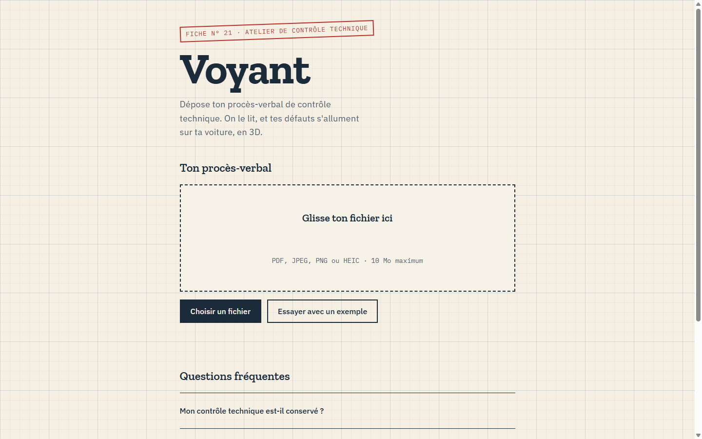
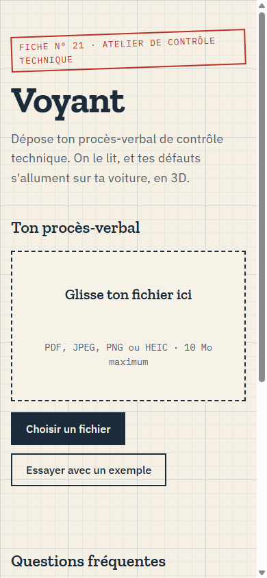

# Voyant · Ton contrôle technique en 3D

🌐 **[voyant.projectp.fr](https://voyant.projectp.fr/)** · Jour 21 du défi **[30 jours, 30 projets](https://projectp.fr/)** · [Dépôt du défi](https://github.com/PierreWZK/30DaysProjects)

Stack : JavaScript, Three.js, Gemini · ⏳ En cours.

[](https://voyant.projectp.fr/)

<p align="center">
  
</p>

Tu déposes ton procès-verbal de contrôle technique (PDF ou photo), une IA de vision le lit, et ta voiture apparaît en 3D avec ses défauts allumés là où ils sont : **orange** pour les défaillances mineures, **rouge** pour les majeures et les critiques. Tu tournes autour, tu zoomes, tu cliques un voyant pour lire le défaut en clair.

📄 Les règles détaillées sont dans le [cahier des charges](CAHIER_DES_CHARGES.md).

## Au programme

- Import du PV en PDF ou en photo (glisser-déposer, ou appareil photo sur téléphone).
- Lecture par IA de vision (Gemini), défauts rendus en JSON et rattachés à une zone de la voiture.
- Une voiture en 3D, la même pour tous les PV, avec les défauts posés sur ses zones.
- Liste des défauts reliée aux voyants : un clic sur l'un fait tourner la caméra vers l'autre.
- Verdict façon tampon d'atelier : favorable, contre-visite, critique.
- Rien n'est stocké : le fichier est analysé puis jeté.

## Lancer en local

```bash
npm install
npm run dev                  # front Vite + API Express
node --test                  # tests unitaires
```

Sans `GEMINI_API_KEY`, l'API répond avec le contrôle technique d'exemple.

## Mise en ligne

Prévue sur Coolify : **https://voyant.projectp.fr**.

## Stack

JavaScript · Vite · Three.js · Node.js (Express) · Gemini.

## Avant de déclarer le projet terminé

> Rappel pour Claude : à faire sur chaque projet, sans que je le redemande (détail dans les sections 9 et 10 du cahier des charges).

- **Indexation** : `robots.txt`, `sitemap.xml`, balise canonical, données structurées JSON-LD (`WebApplication` rattachée à ProjectP) et lien « 30 jours, 30 projets » vers https://projectp.fr/ dans le pied de page. Vérifier en ligne, puis me rappeler de soumettre `https://voyant.projectp.fr/sitemap.xml` dans Google Search Console.
- **Aperçu du lien** : image Open Graph stylisée 1200 × 630 aux couleurs du projet et balises `og:*` / `twitter:card`, vérifiées en ligne.
- **Vitrine** : la mise à jour de `30days30projects` (README, `projects.js`, nouveau dossier `day-21-voyant`) se fait **après ma validation**.

---

## Le défi 30 jours, 30 projets

Un projet complet par jour pendant 30 jours, chacun en ligne sur son propre sous-domaine.

- 🗂️ **Tous les projets** : [projectp.fr](https://projectp.fr/)
- 💻 **Le dépôt du défi** : [github.com/PierreWZK/30DaysProjects](https://github.com/PierreWZK/30DaysProjects)
- ⬅️ **Jour précédent** : [Cartouche, ludothèque](https://cartouche.projectp.fr/)
- ➡️ **Jour suivant** : [THE LAST HUMAN, incremental](https://thelasthuman.projectp.fr/)
